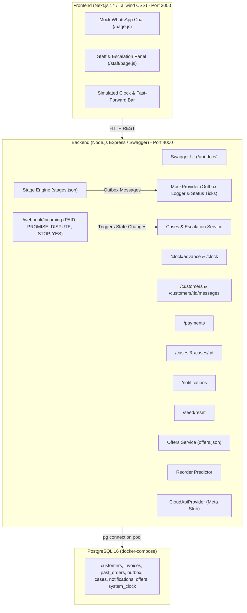

# Wholesale Customer Retention & Payment Follow-up System
## Technical Architecture & Implementation Plan

### 1. Overview & System Purpose
This system automates receivables follow-up, customer retention, offer dispatching, and escalation workflows for a wholesale enterprise offering 15–30 day credit to retail merchants. All WhatsApp interactions are routed through an in-house Mock WhatsApp provider and a web-based test chat panel.

---

### 2. High-Level Architecture

---

### 3. Core Modules & Implementation Details

#### 3.1 Simulated Fake Clock (`services/clock.js`)
- Persisted current date in `system_clock` table (defaults to baseline seed date: `2026-10-20`).
- `POST /clock/advance?days=N`: Moves the simulated clock forward by $N$ days and triggers:
  1. **Stage Engine**: Evaluates all invoices against the 5 stages.
  2. **Case Escalation**: Evaluates open cases; cases open for $\ge 2$ simulated days are escalated to the manager, generating high-priority staff notifications.
  3. **Offers Engine**: Evaluates early-payment discount & win-back voucher qualification.
  4. **Reorder Engine**: Checks 90% order gap threshold for churn prevention.
- Returns comprehensive execution audit log of actions triggered.

#### 3.2 Payment Follow-up Stages (`config/stages.json`)
| Stage Name | Day Offset vs Due Date | Action & Template Behavior |
| :--- | :---: | :--- |
| `pre_due` | -2 | Friendly reminder of upcoming due date. |
| `due_day` | 0 | Reminder with total amount due today. |
| `soft_followup` | +3 | Polite nudge with outstanding balance. |
| `firm_followup` | +7 | Firm demand, automatically opens a case for assigned salesperson. |
| `final_notice` | +15 | Final warning, escalates case to manager. |

**Engine Invariants:**
1. **Idempotence**: A stage fires at most once per invoice.
2. **Auto-Stop on Payment**: If `balance <= 0`, all future stages cease immediately.
3. **Partial Payment Awareness**: Balance dynamically reflects `amount - paid_amount`.
4. **Single Message Per Customer Per Day**: Overdue invoices for the same customer are merged into a single structured follow-up message.
5. **Promise to Pay**: If customer has promised a payment date and `current_date <= promise_date`, follow-ups pause.
6. **Dispute Pause**: If an active dispute case exists, collections pause.
7. **Opt-Out (STOP)**: No further messages sent; alert salesperson.

#### 3.3 Mock WhatsApp & Webhook System
- `MessageProvider` interface with `MockProvider` implementation writing to `outbox` table.
- Simulates status transitions: `sent` $\rightarrow$ `delivered` $\rightarrow$ `read`.
- `POST /webhook/incoming` parses replies:
  - `PAID`: Marks invoice status as under verification or registers payment check.
  - `PROMISE <YYYY-MM-DD>`: Sets customer promise date, updates timeline, pauses reminders until that date.
  - `DISPUTE`: Pauses collection, opens a Dispute case for the salesperson.
  - `STOP`: Sets customer `opt_out = true`, halts all communication, notifies salesperson.
  - `YES`: Converts reorder prompt into a newly created draft order.

#### 3.4 Retention & Offers (`config/offers.json`)
1. **Early-Payment Discount**: 2% off if paid within 3 days of invoice issuance.
2. **Win-Back Offer**: Customers with no order in 45+ days receive a 7-day coupon.
3. **Exclusion Guard**: Customers with any invoice 15+ days overdue never receive offers.

#### 3.5 Reorder Reminders
- Computes mean purchase interval across customer's historical orders.
- When elapsed days reach 90% of interval:
  - If customer has any overdue invoice $\rightarrow$ Payment reminder takes precedence.
  - Otherwise $\rightarrow$ Dispatch reorder prompt with items from the last order.

---

### 4. Six Required Automated Test Scenarios (`scenarios.test.js`)
1. **Scenario 1**: Customer pays before due date $\rightarrow$ No follow-up message is ever sent.
2. **Scenario 2**: Customer pays 40% on day +3 $\rightarrow$ Next reminder shows reduced remaining balance.
3. **Scenario 3**: Customer replies `PROMISE <date>` $\rightarrow$ Reminders pause until date, then resume if unpaid.
4. **Scenario 4**: Customer replies `DISPUTE` $\rightarrow$ Collections pause, dispute case opens for salesperson.
5. **Scenario 5**: Customer replies `STOP` $\rightarrow$ No further messages; salesperson is notified.
6. **Scenario 6**: Customer has 3 overdue invoices $\rightarrow$ Combined into a single message on the follow-up day.
