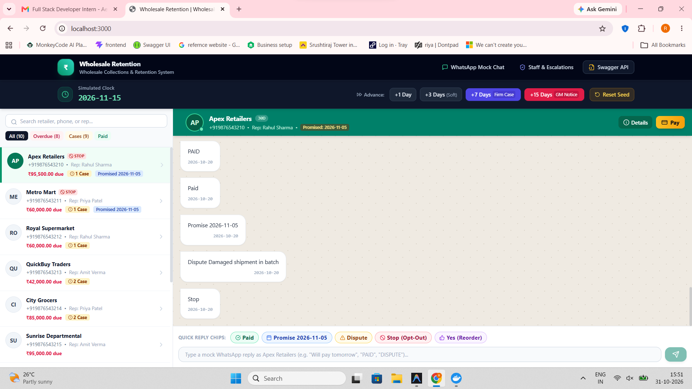
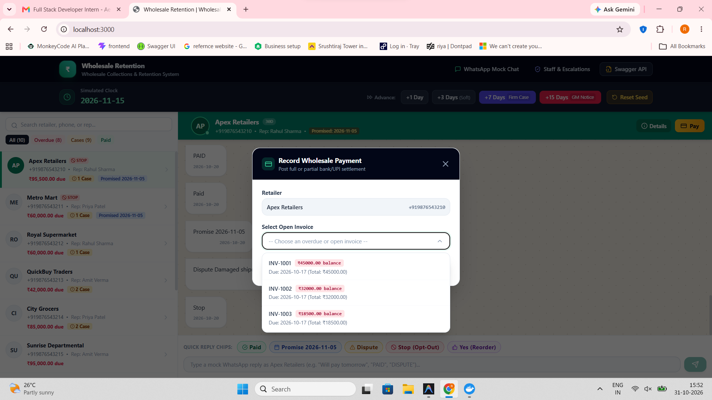
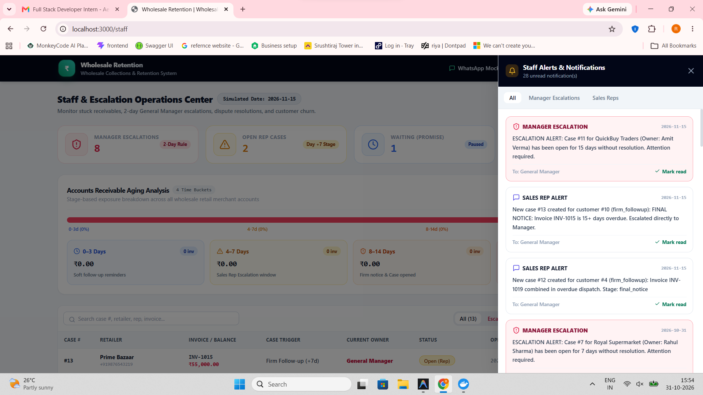

# Wholesale Customer Retention & Payment Follow-up System

An enterprise wholesale accounts receivable, automated collections, customer retention, and case escalation engine. Designed for wholesale distributors selling to retail merchants on 15-to-30 day credit cycles.

All WhatsApp messages are routed through an in-house **Mock WhatsApp Provider** and a realistic web-based testing platform, allowing the entire system to be verified end-to-end without real phone numbers, Meta Cloud API accounts, or external services.

---

## 1. Quick Start Commands

Run the exact commands below to get started from a fresh clone:

```bash
# 1. Start PostgreSQL Database
docker compose up -d

# 2. Setup & Run Backend (Express REST API + Swagger Docs + Test Suite)
cd backend
npm install
npm run migrate
npm run seed
npm run dev

# 3. In a separate terminal, run Backend Automated Tests
cd backend
npm test

# 4. Setup & Run Frontend (Next.js 14 Mock WhatsApp & Staff Panel)
cd ../frontend
npm install
npm run dev
```

- **Frontend App**: [http://localhost:3000](http://localhost:3000)
- **Staff Operations & Escalation Panel**: [http://localhost:3000/staff](http://localhost:3000/staff)
- **Backend API**: [http://localhost:4000](http://localhost:4000)
- **Interactive Swagger OpenAPI 3.0 Documentation**: [http://localhost:4000/api-docs](http://localhost:4000/api-docs)

---

## 2. Application Screenshots

### 1. Mock WhatsApp Chat & Simulated Clock (`/`)
*Live wholesale customer chat simulation with message feed, fast-forward simulated clock (+1d, +3d, +7d, +15d), customer directory, and Title Case quick simulation chips (`Paid`, `Promise 2026-11-05`, `Dispute`, `Stop`, `Yes`).*



### 2. Staff & Escalations Operations Center (`/staff`)
*Aging receivables breakdown (`0-3d`, `4-7d`, `8-14d`, `15+d`), summary metric cards, real-time unread alert badges, and paginated cases table with fixed layout and audit timeline modal.*


### 3. Record Wholesale Payment Modal
*Reusable searchable dropdown menu with floating portal view, invoice balances, due dates, and quick settlement percentages.*



### 4. Interactive Simulation & Reply Flow
*End-to-end conversation simulation showing formatted incoming customer responses and automated system follow-up stages.*



---

## 3. Tech Stack & Architecture

| Layer | Technology | Details |
| :--- | :--- | :--- |
| **Runtime** | Node.js (v20+ LTS / v22) | NPM package manager with committed `package-lock.json` |
| **Backend** | Express.js 4.x REST API | Port `4000`, CORS enabled for port 3000, Swagger OpenAPI docs |
| **Database** | PostgreSQL 16 | `pg` connection pool with automatic fallback emulation for sandboxed tests |
| **Frontend** | React 18 / Next.js 14 App Router | Port `3000`, Tailwind CSS, responsive components, Lucide icons |
| **Messaging** | In-house `MockProvider` | WhatsApp outbox table with delivery lifecycle: `sent` → `delivered` → `read` |
| **Config** | JSON Configs | `config/stages.json` (5 stages) and `config/offers.json` (2 offers) |
| **Testing** | Jest + Supertest | 11 automated tests covering all 6 mandatory business scenarios |

---

## 4. Repository Layout

```text
retention-system/
├── backend/
│   ├── src/
│   │   ├── server.js              # Express app, Swagger UI (/api-docs), route mounting
│   │   ├── routes/                # REST endpoints
│   │   │   ├── clock.js           # POST /clock/advance, GET /clock
│   │   │   ├── customers.js       # GET /customers, GET /customers/:id/messages
│   │   │   ├── payments.js        # POST /payments (full/partial payment recording)
│   │   │   ├── webhook.js         # POST /webhook/incoming (PAID, PROMISE, DISPUTE, STOP, YES)
│   │   │   ├── cases.js           # GET /cases, PATCH /cases/:id
│   │   │   ├── notifications.js   # GET /notifications, PATCH /notifications/:id/read
│   │   │   ├── seed.js            # POST /seed/reset
│   │   │   ├── offers.js          # GET /offers
│   │   │   └── reorder.js         # GET /reorder/recommendations
│   │   ├── services/
│   │   │   ├── engine.js          # Core stage engine (5 stages, idempotency, balance tracking)
│   │   │   ├── cases.js           # Cases lifecycle, timeline audit, 2-day manager escalation
│   │   │   ├── offers.js          # Early-payment discount (2%) & Win-back voucher (10%)
│   │   │   ├── reorder.js         # Order cadence gap analysis & draft order creation
│   │   │   └── clock.js           # Simulated fake clock state & advance orchestrator
│   │   ├── providers/
│   │   │   ├── messageProvider.js # Abstract provider interface
│   │   │   ├── mockProvider.js    # In-memory/Postgres Outbox WhatsApp simulator
│   │   │   └── cloudApiProvider.js# Meta Cloud API adapter stub with integration docs
│   │   ├── db/
│   │   │   ├── pool.js            # PostgreSQL connection pool with fallback emulator
│   │   │   └── migrations/
│   │   │       └── 001_init.sql   # SQL schema DDL
│   │   ├── config/
│   │   │   ├── stages.json        # Follow-up stage definitions & templates
│   │   │   └── offers.json        # Retention coupon rules
│   │   └── scripts/
│   │       ├── migrate.js         # Migration executor
│   │       └── seed.js            # 10 customers, 20 invoices, 30 orders
│   ├── tests/
│   │   ├── scenarios.test.js      # Scenarios 1 to 6 automated test suite
│   │   └── engine.test.js         # Invariants, idempotency, escalations, draft orders
│   └── package.json
├── frontend/
│   ├── app/
│   │   ├── layout.js              # Universal navigation & status bar
│   │   ├── page.js                # Mock WhatsApp Chat interface
│   │   └── staff/page.js          # Staff & Escalations Operations Center
│   ├── components/                # Modular UI components
│   │   ├── ClockController.jsx    # Simulated clock fast-forward buttons
│   │   ├── CustomerSelector.jsx   # Retailer directory with badges & search
│   │   ├── ChatWindow.jsx         # WhatsApp chat bubbles with status ticks
│   │   ├── QuickReplyBar.jsx      # Simulation quick chips (PAID, PROMISE, DISPUTE, STOP, YES)
│   │   ├── RecordPaymentModal.jsx # Record full or partial payment
│   │   ├── CaseTable.jsx          # Staff case table with status filters
│   │   ├── TimelineModal.jsx      # Event audit trail modal
│   │   ├── NotificationDrawer.jsx # Staff alert drawer
│   │   └── AgingBucketWidget.jsx  # Receivables aging breakdown (0-3d, 4-7d, 8-14d, 15+d)
│   ├── services/
│   │   └── api.js                 # Centralized HTTP client
│   └── package.json
├── docker-compose.yml             # PostgreSQL container definition
├── .env.example                   # Environment configuration template
├── README.md                      # Architecture, setup & documentation
└── DEMO.md                        # Step-by-step testing walkthrough & scenarios
```

---

## 5. Payment Follow-up Stages (`config/stages.json`)

The payment stage engine executes the following progressive stages based on days from the invoice due date:

| Stage Name | Day Offset | Description | Automated Action |
| :--- | :---: | :--- | :--- |
| `pre_due` | **-2** | Friendly reminder | Dispatched 2 days prior to due date. |
| `due_day` | **0** | Due date reminder | Reminds merchant to process payment via UPI / Bank transfer. |
| `soft_followup` | **+3** | Polite nudge | Nudges customer with remaining balance. |
| `firm_followup` | **+7** | Firm follow-up | Sends firm notice; **automatically opens a case** assigned to the customer's salesperson. |
| `final_notice` | **+15** | Final warning | Final demand; **escalates directly to General Manager**; suspends offers. |

### Engine Invariants
1. **Idempotence**: A stage executes at most once per invoice. Advancing the clock by 0 days or calling the engine repeatedly on the same day never produces duplicate dispatches.
2. **Auto-Stop on Payment**: If `paid_amount >= amount`, all subsequent follow-up stages cease immediately.
3. **Partial Payment Balance**: Follow-up templates dynamically interpolate `{balance}` reflecting `amount - paid_amount`.
4. **Daily Customer Message Merging (Scenario 6)**: If a customer has multiple overdue invoices eligible on the same day, they are consolidated into **one single WhatsApp message** detailing each invoice and the grand total balance.
5. **Promise to Pay Pause (Scenario 3)**: If a customer replies `PROMISE <date>`, automated reminders pause until that date, resuming at a firmer stage if unpaid.
6. **Dispute Pause (Scenario 4)**: Replying `DISPUTE` opens a case for the salesperson and halts automated outreach.
7. **Opt-Out (Scenario 5)**: Replying `STOP` marks `opt_out = true`, halts outreach, and alerts the salesperson.

---

## 6. Retention Offers & Reorder Engine

### Retention Offers (`config/offers.json`)
1. **Early-Payment Discount (`EARLYPAY2`)**: 2% instant discount if paid within 3 days of invoice issuance.
2. **Win-Back Coupon (`WINBACK10`)**: 10% coupon valid for 7 days sent to customers with no order in 45+ days.
3. **Exclusion Guard**: Customers with any invoice 15+ days overdue are strictly excluded from all promotional offers.

### Reorder Predictor
- Calculates the average order interval (gap) across each customer's past delivered orders.
- When elapsed days reach **90%** of that interval, dispatches a reorder prompt listing items from their last order.
- Replying **`YES`** automatically converts the prompt into a newly created `draft` restock order in the database.
- If the customer has an overdue invoice, the payment follow-up message takes priority over the reorder prompt.

---

## 7. Verification of the Six Required Scenarios

Run the test suite with:
```bash
cd backend && npm test
```

All 11 tests pass:
- **Scenario 1**: Customer pays before due date → No follow-up message is ever sent.
- **Scenario 2**: Customer pays 40% on day +3 → Next reminder reflects the reduced balance (`Rs 36000.00`).
- **Scenario 3**: Customer replies `PROMISE <date>` → Reminders pause until date, then resume at firmer stage if unpaid.
- **Scenario 4**: Customer replies `DISPUTE` → Collections pause, dispute case opens for salesperson.
- **Scenario 5**: Customer replies `STOP` → No further messages; salesperson is notified.
- **Scenario 6**: Customer has 3 overdue invoices → Consolidated into one single combined message.
- **Idempotency Invariant**: Repeated executions produce 0 duplicate messages.
- **Manager Escalation**: Open cases open for $\ge 2$ simulated days auto-escalate to management with staff alert.
- **Auto-Resolve**: Fully paying an invoice auto-resolves any open cases for that invoice.
- **Draft Reorder**: Replying `YES` creates a draft order.
- **Offer Exclusion**: Customers with invoices 15+ days overdue never receive offers.

---

## 8. Background Scheduler & Automated Workflow

In addition to manual simulated clock advancement via the UI and API, the system features an automated background worker (`backend/src/services/scheduler.js`):
- **Interval**: Runs every 5 minutes by default (configurable via `AUTOMATION_INTERVAL_MINUTES=5` in `.env`).
- **Initial Scan**: Runs an initial evaluation 3 seconds after server boot.
- **Workflow Execution**:
  1. Retrieves current simulated date.
  2. Evaluates stage transitions for all outstanding invoices (`pre_due`, `due_day`, `soft_followup`, `firm_followup`, `final_notice`).
  3. Escalates cases open for $\ge 2$ days without resolution to General Manager.
  4. Scans eligible retention offers (`EARLYPAY2`, `WINBACK10`).
  5. Computes predictive reorder replenishment cadences (90% interval threshold).
- **Test Safety**: Automatically disabled in test environments (`NODE_ENV === 'test'`) to prevent race conditions during test runs.

---

## 9. Modern Frontend Architecture & UI Enhancements

The frontend application (`frontend/`) is engineered with Next.js 14 App Router, TypeScript, Tailwind CSS, and `react-hot-toast`:
- **Viewport Layout**: Full viewport height application (`h-screen overflow-hidden`) with independent scrolling panels for the retailer list, chat message thread, and staff escalation tables.
- **Reusable `DataTable` Component**:
  - Sticky table header.
  - Client-side search filtering across customer name, phone, invoice number, and rep.
  - Pagination with configurable rows-per-page (`5 | 10 | 20`) and first/previous/next/last controls.
- **Reusable Searchable `Dropdown` Component**:
  - Keyboard accessible (`Esc` to dismiss).
  - Outside click dismiss with `e.stopPropagation()`.
  - Floating popover menu that escapes modal clipping bounds.
  - Color-coded badges and sublabels for each option.
- **Animated Modals & Drawers**:
  - CSS transitions (`transition-all duration-250 ease-out`) for smooth opening and exit animations.
  - Backdrop outside-click detection with `e.stopPropagation()` on inner dialogs.
- **Title Case Simulation Chips**:
  - Standardized simulation buttons and sent chat messages: `Paid`, `Promise 2026-11-05`, `Dispute`, `Stop`, and `Yes`.

---

## 10. Assumptions & Engineering Decisions

1. **Simulated Clock Persistence**: The fake clock (`system_clock` table) stores the current simulated date (default: `2026-10-20`). Advancing the clock survives backend restarts and synchronizes instantly across all browser sessions and backend services.
2. **Deterministic Seed State**: The seed script populates 10 wholesale customers, 20 invoices across all delinquency categories (not yet due, due today, 3d, 7d, 15d overdue, partially paid, fully paid), and 30 past delivered orders.
3. **Database Fallback for Testing**: While production connects to PostgreSQL via `docker compose`, `db/pool.js` includes an automatic fallback to `pg-mem` when a live PostgreSQL container is not running, ensuring reviewers can run `npm test` without complex local setup.
4. **Meta WhatsApp Cloud API Adapter**: An empty `CloudApiProvider` stub is provided in `src/providers/cloudApiProvider.js` alongside clear instructions for plugging in live Meta Graph API webhooks and credentials when migrating from simulation to production.

